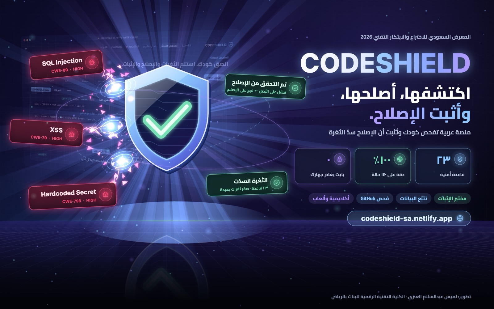
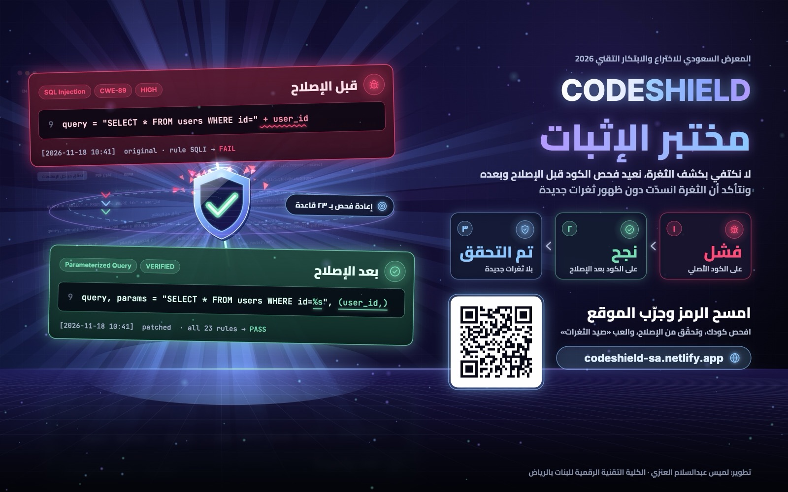

# كودشيلد | CodeShield

**اكتشفها، أصلحها، وأثبت الإصلاح.**
منصة ويب عربية تفحص الكود وتكتشف الثغرات الأمنية، وتشرحها بالعربي، وتقترح إصلاحًا جاهزًا، ثم **تُثبت** أن الإصلاح سدّ الثغرة. كل شيء يعمل داخل المتصفح.

🔗 **جرّبها الآن:** [codeshield-sa.netlify.app](https://codeshield-sa.netlify.app)

## المشكلة
- أغلب أدوات فحص الكود تنبّه إلى الثغرة، ثم تترك المطوّر يخمّن: هل نجح إصلاحه فعلًا؟
- أغلبها بالإنجليزية، فيصعب على المبتدئ العربي فهم الخطر وطريقة الإصلاح.
- كثير منها يتطلّب رفع الكود إلى خوادم خارجية.

## المزايا
- **مختبر الإثبات:** يعيد فحص الكود قبل الإصلاح وبعده. يفشل على الأصل وينجح على المعدّل بكل القواعد، فتتأكد أن الثغرة انسدّت دون ثغرات جديدة.
- **٢٣ قاعدة أمنية** مربوطة بمعايير CWE وOWASP Top 10، بثلاث درجات خطورة.
- **متتبّع البيانات:** يلاحق مدخل المستخدم غير الموثوق من مكان دخوله إلى السطر الخطِر.
- **عربي أولًا:** شرح كامل لكل ثغرة وإصلاحها بالعربية، مع واجهة إنجليزية.
- **خصوصية تامة:** الفحص داخل المتصفح، والبيانات محفوظة محليًا (IndexedDB)، وبدون حساب.
- **فحص مشاريع كاملة:** من مستودعات GitHub العامة أو مجلدات من الجهاز.
- **تقارير** بصيغة PDF وSARIF.
- **أكاديمية:** ٢٣ درسًا، ولعبة «صيد الثغرات» بثلاثة مستويات، و١٤ شارة إنجاز.

## النتائج
| الاختبار | النتيجة |
|---|---|
| مجموعة اختبار من إعداد المشروع (١٤٠ حالة) | كُشفت كل الحالات المصابة (٨١)، ودون أي إنذار خاطئ على الحالات الآمنة (٥٩) |
| مشروع PyGoat المفتوح المصدر (١٥٠ ملفًا، ٨٬٠٦٧ سطرًا) | ٤٩ نتيجة، وكُشفت ٣ إنذارات خاطئة فصُحّحت القواعد |

> ملاحظة بصراحة: مجموعة الاختبار كُتبت مع القواعد، فهي لكشف التراجع وليست معيارًا مستقلًا. والدقة في المشاريع الحقيقية متوقّع أن تكون أقل. الخطوة القادمة: القياس على OWASP Benchmark.

## التقنيات
HTML5 · CSS3 · JavaScript (ES Modules) · IndexedDB · GitHub API · SARIF · PWA · Netlify مع ترويسات أمان CSP. بدون مكتبات خارجية.

## خارطة الطريق
- **v0.6:** تتبّع البيانات عبر الدوال (تحليل AST).
- **v0.7:** تشغيل اختبارات الوحدة داخل المتصفح، والقياس على OWASP Benchmark.
- **v1.0:** ذكاء اصطناعي يساعد في صياغة الإصلاحات، وإضافة لمحرر VS Code، وحسابات للفرق.

## المشاركات
مشروع مشارك في **المعرض السعودي للاختراع والابتكار التقني 2026 (STIEX)**.

## المطوّرة
**لميس عبدالسلام العنزي**، طالبة تقنية البرمجيات وتطوير الويب، الكلية التقنية الرقمية للبنات بالرياض.
بإشراف د. ابتهال العبلاني.
طُوّر المشروع بمساعدة أدوات الذكاء الاصطناعي.

---

## English

**CodeShield: find it, fix it, prove the fix.**
An Arabic-first web app that scans code for security vulnerabilities, explains each one in Arabic, suggests a ready fix, and then **proves** the fix closed the hole. Everything runs in the browser.

**Live:** [codeshield-sa.netlify.app](https://codeshield-sa.netlify.app)

- **Proof Lab:** re-scans the code before and after the fix. It must fail on the original and pass on the patched code across all rules.
- **23 rules** mapped to CWE and OWASP Top 10, plus taint tracking from user input to dangerous sinks.
- **Private by design:** in-browser scanning, local storage (IndexedDB), no account.
- GitHub repository and folder scanning, PDF and SARIF reports, and an academy with lessons, a game and badges.
- On the project's own labelled set of 140 cases: all 81 vulnerable cases detected, no false positives on the 59 safe ones. That set was written alongside the rules, so real-world accuracy is expected to be lower. A scan of the open-source PyGoat project (150 files, 8,067 lines) surfaced 3 false positives, which were fixed.

Built with plain HTML, CSS and JavaScript, with no external libraries. Developed with the help of AI tools.

**Author:** Lamis Alanazi, Software & Web Development student, Digital Technical College for Girls, Riyadh. Supervised by Dr. Ibtihal Al-Ablani.

© 2026 Lamis Alanazi. All rights reserved. See [LICENSE](LICENSE).
